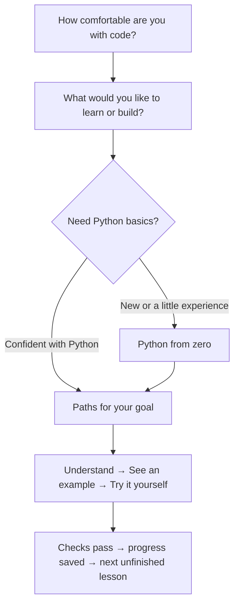

# Start here if you have hardly coded

You can start without knowing Python, JavaScript, machine learning or how to use a code editor. After installing the app, you can read, edit and run the lessons inside Engineering Workshop. You do not need a separate editor or an AI account.

## Choose a starting point

On **Paths**, answer two optional questions: how comfortable you are with code, and what you would like to learn or build. Choose the new-to-coding option if you have never coded or mostly followed tutorials. It is fine to choose exploring as your goal.

The app suggests an ordered set of its existing paths and explains each step. New learners and people who have written a little code start with **Python from zero**. If you already write Python confidently, you can begin with the subjects for your goal. You can change your answers later or open any lesson at any time.

The suggestions are a study plan, not a skills test or a promise of job readiness. They cover small exercises; becoming comfortable in a role also takes larger projects, practice and feedback.

## What the words on the screen mean

- **Code** is written instructions for the computer. A **program** runs those instructions. The first path teaches the instructions a little at a time.
- The **editor** is the box where you change code. The lesson supplies starter code, so you do not have to begin with a blank page.
- **Output** is what your program displays when it runs. `print(7)` displays `7`; the word `print` does not mean using a printer.
- An **error** is a message about something the computer could not do. It is feedback, and getting one does not erase your progress.
- A **check** tries your code with examples to see whether it behaves as the task asks. Running code and passing checks are separate actions.

## Your first lesson

1. Open **Python from zero → Store and print values**. Read **Understand**. You do not need to memorize it.
2. Open **See an example**. Read the code, make a prediction, then run the example. Compare its output with your prediction.
3. Open **Try it yourself** and select **Run code** before changing anything. The starter prints `0`. This is expected: it has not solved the task yet.
4. Change `price` to `2`, `delivery` to `1`, and `total` to `items * price + delivery`. Keep `print(total)` at the end. `*` means multiply; `=` stores a value under a name.
5. Select **Run code** again. The output should be `7`.
6. Select **Check answer**. When all checks pass, the lesson is complete. Return to **Paths** to see the next unfinished lesson in your plan.

**Run code** shows what the program does. **Check answer** checks whether it solves the exercise and saves completion. A successful run alone does not complete a lesson.

## When you get stuck

Read the short error explanation or the failed check's expected and actual values. Change one thing, then run again. Open hints one at a time. **Show solution** lets you compare an answer with your code; try to explain the difference, then write it yourself. Notes are a good place to record one thing you learned.

You can use the buttons without learning keyboard shortcuts. To leave the code editor with the keyboard, press Esc, then Tab. The **Glossary** explains unfamiliar words, and **You'll use** links to earlier lessons that teach the code a lesson needs.

## Match practice to your goal

| Goal | What the suggested subjects help you practice |
| --- | --- |
| Explore and find my direction | Try ML foundations, web, data and agent concepts before choosing a focus |
| Machine learning and AI | Predictions and training, then PyTorch, TensorFlow and the modern AI stack |
| AI agents and reliable systems | APIs, agent loops, data handling and reliability checks |
| Web apps and product engineering | APIs, JavaScript and interface state, interactive systems and shipping checks |
| Data and retrieval engineering | Data cleanup, chunking and retrieval, APIs and reliability |

These are suggestions. CUDA and reinforcement learning remain available in **All paths** if they fit your interests. **Projects** gives you larger source examples to apply what you learn; its setup commands can introduce tools beyond the in-app lessons. Start with lessons before attempting a project if those tools are unfamiliar.

## Your work stays on this computer

Your answers and progress are saved locally, and your learning profile is included when you export progress. There is no account or required AI service. The optional AI assistant has separate settings and sends questions only when you enable it and choose to ask. Changing your learning goal keeps your completed lessons, code and notes.
