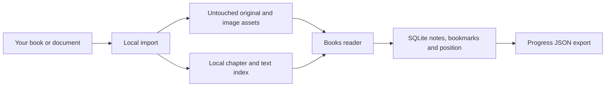

# Local book library

Open **Books** in Engineering Workshop. Imported books and documents are available offline, with chapter navigation, text search, bookmarks, reading notes, and a saved page or section. The three suggested books also have reading guides that link to related lessons.

## Import your own copy

Open **Books**. The **GPU Glossary**, **Inference Engineering** and **An engineer’s guide to harnesses** cards each have a drop area and **Choose file** button. Drop one PDF or EPUB onto the matching card, or choose it from your computer. **Read on Modal** opens the online glossary; **Get a free copy** and **Request a free copy** open Baseten's pages for its two titles. The app does not download or bundle any of these books for you.

Modal publishes the *GPU Glossary* as a website, with its Markdown source on [GitHub](https://github.com/modal-labs/gpu-glossary) under CC BY 4.0. There is no official EPUB or PDF, so the card accepts a copy you made yourself. Baseten offers *Inference Engineering* as a free PDF. It sends *An engineer's guide to harnesses* as a free PDF after you fill in a short form with your name and email.

Uploads show progress, followed by a chapter/search preparation step. When **Ready to read** appears, choose **Read book** or **Open book**; no reload or terminal command is needed. On the Mac app, **Choose file** opens a native file picker.

Use **Add another book** for any other supported file, or to keep a second edition. Reimporting the same file returns the existing copy without resetting notes or reading position. A file of another type shows a message that lists the supported types.

## Supported files

| Type | Extensions | How it reads | Size limit |
|---|---|---|---|
| PDF | `.pdf` | Original pages, rendered with PDF.js | 100 MB |
| EPUB | `.epub` | Sections from the book's spine | 100 MB |
| Word | `.docx` | Headings, paragraphs, lists, simple tables and pictures | 100 MB |
| Markdown | `.md`, `.markdown` | Converted to sections at the top-level headings | 16 MB |
| Plain text | `.txt` | Paragraphs, in sections of about 60,000 characters, with a **Monospace** switch | 16 MB |
| HTML | `.html`, `.htm` | One saved page, split at its top-level headings | 32 MB |
| Jupyter notebook | `.ipynb` | Markdown cells, code cells with their language and saved outputs | 50 MB |
| Image | `.png`, `.jpg`, `.jpeg`, `.webp`, `.gif` | A one-page book | 50 MB |

Every book shows its type as a badge on its card and in the reader. Search, bookmarks, reading notes and the saved position work the same way for every type. A section is one part of the converted file; a PDF or an image counts pages instead.

Converted files keep their text, links and pictures, not their page layout or styles:

- **Markdown** supports headings, paragraphs, lists, block quotes, code blocks, inline code, emphasis, tables, links and images. Links work only to web pages (http or https) or to headings in the same file. Raw HTML in the file is removed, and an image from outside the file shows a short note instead.
- **HTML** keeps the page's text, links to web pages and pictures embedded in the file as `data:` images. Scripts, styles, forms, frames, embedded objects and remote images are removed, so nothing loads from the network.
- **Word** files keep headings, bold and italic text, lists, tables, links and pictures stored in the file. Headers, footers, footnotes, comments and deleted text are not included.
- **Notebooks** show markdown cells, code cells labelled with their execution count and language, and saved text, error and image outputs. Cells never run. HTML table outputs, such as data frames, pass through the same filter as HTML files; JavaScript and widget outputs show their plain text or a short note.
- **Images** open as a single page and serve as the book's cover.
- One file is one book. To keep several images together, combine them into a PDF first.

**Remove book** on a book's card deletes the copy stored in `data/library/<id>/` after you confirm. It does not delete the file you imported, and your notes, bookmarks and reading position stay in the progress database, so importing the same file again brings them back. A different edition cannot overwrite a suggested book; import it separately instead. A suggested book's card checks the title inside the file; a verified edition with no title inside it, such as Baseten's harness guide PDF, is recognized by its SHA-256 checksum. Files must be non-empty and within the size limit for their type. Invalid, encrypted, or interrupted imports show an error and can be retried without changing existing books. A stored book whose `book.json` is damaged shows as **Could not open this book** with **Remove book**; the other books still open.

PDFs preserve their original printed layout, fonts and diagrams. EPUBs use a responsive reading layout and retain original image resolution. Reading guides appear only when their locations match: glossary sections by source file name (such as `device-software--kernel`) or by section title (such as "What is a Kernel?"), and the verified PDF editions of *Inference Engineering* and *An engineer's guide to harnesses*. The harness guide's pages are images with no text layer, so its guides link by page number. Other editions and formats still support reading, search, notes and bookmarks.

### Optional command-line import

In a clone, run Setup first, then import from the project directory:

```sh
.venv/bin/python scripts/import-books.py \
  --epub "$HOME/Downloads/GPU-Glossary.epub" \
  --pdf "$HOME/Desktop/Inference Engineering.pdf"
```

Use either option separately if you only have one book. For another book:

```sh
.venv/bin/python scripts/import-books.py --file "/path/to/book.pdf" --id my-book
```

In a copy made by the install command, run the importer with the Python in its `app` folder. On macOS and Linux:

```sh
~/.local/share/engineering-workshop/app/.venv/bin/python \
  ~/.local/share/engineering-workshop/app/scripts/import-books.py --epub "$HOME/Downloads/GPU-Glossary.epub"
```

On Windows, in PowerShell:

```powershell
& "$env:LOCALAPPDATA\EngineeringWorkshop\app\.venv\Scripts\python.exe" `
  "$env:LOCALAPPDATA\EngineeringWorkshop\app\scripts\import-books.py" --pdf "$HOME\Desktop\Inference Engineering.pdf"
```

Books then go into the `data` folder next to `app`, so updates keep them.

Reload the app after importing. The importer copies the original into `data/library/<id>/`, builds a local text index, and prints its SHA-256 checksum. It never modifies the supplied file. Reimporting an identical edition is safe; an older index format is rebuilt when needed. Use a new ID for a different edition so existing reading positions remain meaningful.

PDF import uses `pypdf`; the browser renders with a locally bundled PDF.js worker, fonts, character maps, color profiles, and decoders. Setup installs these dependencies. Reading does not use a CDN or a remote document service.

## Read and study

- Search from the Books page to search the library, or within a book to narrow results. Search requires two characters and returns up to 60 matching pages or sections.
- Use Contents or the page field to navigate. For PDFs, the page field counts physical pages; the reader also displays the book's printed page label. The table of contents uses printed labels.
- Open **Reading guides** for suggested readings, a reading question, and a related lesson. **Mark reviewed** records your own review; it does not award lesson XP.
- Use the bookmark button and **Saved** tab to return to useful sections. **Reading notes** holds notes for the whole book.
- Related lessons show a **Related reading** list when the matching books are imported.

## Figure quality

EPUB image assets are copied byte-for-byte, including their original resolution and format. Click or keyboard-activate an illustration to enlarge it, see its pixel dimensions, or open the image file. Zooming a raster picture cannot add detail absent from the source.

PDF pages are rendered directly from the original PDF, preserving its vector diagrams, embedded fonts, and source image streams. Zoom rerenders the page at the selected size, rather than enlarging a saved screenshot. Rendering respects display pixel density, with a 24-million-pixel canvas limit. **Download PDF** saves the untouched file for other viewing or printing tools, including browsers without a built-in PDF viewer.

The EPUB reader adapts typography and strips executable content, source styles, and remote images. Captions, source links, and image attribution remain in the reading content. Complex EPUB layout, MathML, audio/video, and arbitrary embedded documents are not supported.

The line above a PDF page shows the printed page number when the PDF has page labels, or when it is a known edition whose printed numbers are offset from its page numbers. Otherwise it shows **Page n of N**.

### PDFs and images without a text layer

PDF search and selectable text depend on a text layer. A PDF made of artwork or scans, such as Baseten's harness guide, still imports and reads page by page. Its contents list uses the PDF's outline if it has one, or page numbers. In place of the search box, the reader says **This PDF has no text layer, so search is not available**. Images work the same way.

If [Tesseract](https://github.com/tesseract-ocr/tesseract) is installed, the reader also offers **Make searchable (OCR)**. Workshop renders each page in the browser at about 300 dpi, and the local server reads it with Tesseract. Each page has a 60-second limit, and OCR reads at most 300 pages of one book. **Stop** keeps the pages read so far, and **Continue OCR** resumes. The recognized text is used for search and shown under **Text read by OCR**. Nothing is downloaded and no page leaves the computer. Without Tesseract, the reader shows one line on how to install it, for example `brew install tesseract` on macOS, then restart Workshop. Workshop finds Tesseract on the `PATH`, and also in the usual Homebrew folders on macOS and in `C:\Program Files\Tesseract-OCR` on Windows.

## Storage, backups, and source rights



Original files, extracted text, and images stay in the Git-ignored `data/library/` directory. Reading position, notes, bookmarks, and guide review status are stored in `data/workshop.sqlite3`, with a browser cache for pending saves. **Settings → Export progress and notes** includes reading state in version 3 JSON exports (alongside project notes and the local project catalog). It does not include the book files. For a full restore, stop the app and back up the entire `data/` directory. JSON import is not yet implemented.

The app's MIT license covers the app source and its reading guides. Imported books and figures retain their own rights and are not distributed with the repository. Obtain your own copies of [Modal's GPU Glossary](https://modal.com/gpu-glossary), *Inference Engineering* by Philip Kiely and [*An engineer's guide to harnesses*](https://www.baseten.co/harness-engineering-guide/) by Alex Ker and Zak Keener. The glossary's supplied license covers its Markdown text under CC BY 4.0; individual figure attributions still apply. The *Inference Engineering* and harness guide PDFs are copyrighted by Baseten Labs Inc.

Browser imports go only to the local Workshop server, with the same Host/Origin and session-token checks as other writes. One upload runs at a time, with a 100 MB input limit, a 60-second upload limit and a 90-second parsing limit. Parsing runs in a disposable subprocess and publishes only a complete book; failed imports remove temporary files, and staging folders left by a stopped server are removed at a later import. EPUB limits: 250 MB of unpacked files, 2,000 sections (a section listed more than once is kept once), 8 MB per unpacked file, 64 MB of extracted text and markup for the whole book, and 2,000 images with 150 MB of image data. PDF limits: 10,000 pages and 64 MB of extracted text. Word files have the EPUB archive limits, 16 MB for the unpacked document and 32 MB per picture, and refuse XML entity declarations and paths outside the file. Markdown, text, HTML and notebooks are limited to 2,000 sections, 64 MB of text and markup, 8 MB per section and one million elements; notebooks also to 5,000 cells, 50 outputs per cell and 50,000 characters per text output. Embedded pictures share the image limits above, at most 10 MB each for `data:` images and notebook outputs, and every image must be a PNG, JPEG, WebP or GIF of at most 64 megapixels. An import over a limit stops with a message that names the limit. The reader sanitizes EPUB markup and every converted format with the same filter, prefixes the book's class names and ids with `bk-` so they cannot match the app's own styles, keeps the chapter inside its page area, and serves only manifest-listed assets. A source link from the EPUB metadata is kept only if it is an http or https URL. This is a personal library, not a public document hosting service.
